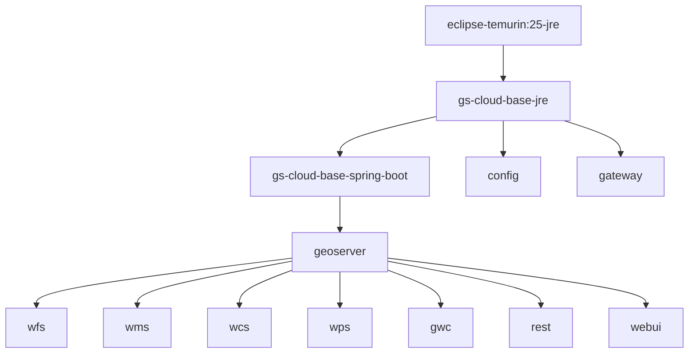

# Docker Images

This document explains the Docker image architecture in GeoServer Cloud, including the base image hierarchy and layer sharing strategy that optimizes disk usage and build times.

## Base Image Hierarchy

GeoServer Cloud uses a layered base image strategy to maximize layer sharing across all microservices:



### Base Images

| Image | Based On | Adds |
|-------|----------|------|
| `gs-cloud-base-jre` | `eclipse-temurin:25-jre` | JVM options (`--add-opens`, heap settings), system CA certificates |
| `gs-cloud-base-spring-boot` | `gs-cloud-base-jre` | Spring Boot layered JAR structure, curl for health checks, default config |

### GeoServer Images

The `geoserver` image extends `gs-cloud-base-spring-boot` with the fonts (DejaVu, Noto, Roboto, etc.), the GeoServer application with all its services, the DuckDB extensions and the JVM AOT cache.

The GeoServer service images (WFS, WMS, WCS, WPS, GWC, REST, WebUI) are built from the `geoserver` image. Each adds only what makes the container run as that service.

Infrastructure services (Config, Gateway) extend `gs-cloud-base-spring-boot` directly since they don't need GeoServer dependencies.

Consul uses the official `hashicorp/consul` image and is not part of this internal hierarchy.

## Layer Sharing

The GeoServer service images share the layers of the `geoserver` image, about 1.84GB. Each adds about 50kB.

**Actual disk usage for all 7 GeoServer services:**

```
1.84GB (shared once) + 7 × 50kB = ~1.84GB
```

Instead of 7 × 1.84GB = 12.9GB apparent.

This means deploying all 7 GeoServer services uses less than 2GB of actual disk space, not 12.9GB as the individual image sizes might suggest.

## Analyzing Layer Sharing

### Check Actual Disk Usage

Use `docker system df -v` to see actual disk consumption with shared vs unique sizes:

```bash
docker system df -v | grep -A 50 "REPOSITORY"
```

Example output:

```
REPOSITORY                                     TAG              IMAGE ID       SIZE      SHARED SIZE   UNIQUE SIZE
geoservercloud/geoserver-cloud-wfs             3.1.0-SNAPSHOT   7f150cae2d24   1.84GB    1.838GB       50.16kB
geoservercloud/geoserver-cloud-wms             3.1.0-SNAPSHOT   85790c8e2daf   1.84GB    1.838GB       50.16kB
...
```

### Compare Layers Across Images

To see which layers are shared across images:

```bash
for img in geoservercloud/geoserver-cloud-{wms,wfs,wcs,wps,gwc,webui,rest}:3.1.0-SNAPSHOT; do
  echo "=== $img ==="
  docker inspect "$img" --format='{{range .RootFS.Layers}}{{.}}{{"\n"}}{{end}}'
done | sort | uniq -c | sort -rn
```

Layers appearing 7 times are shared across all services (the layers of the `geoserver` image). Layers appearing once are unique to each service.

### Count Total vs Unique Layers

```bash
# Dump all layers
for img in $(docker images --format '{{.Repository}}:{{.Tag}}' | grep 3.1.0-SNAPSHOT); do
  docker inspect "$img" --format='{{range .RootFS.Layers}}{{.}}{{"\n"}}{{end}}'
done > /tmp/all-layers.txt

# Count
echo "Total layer references: $(wc -l < /tmp/all-layers.txt)"
echo "Unique layers: $(sort -u /tmp/all-layers.txt | wc -l)"
```

## Labels

The images describe themselves with the [OCI image labels](https://github.com/opencontainers/image-spec/blob/main/annotations.md): title, description, version, revision (the git commit of the build), creation date, source repository, documentation, license, vendor and authors.

```bash
docker inspect geoservercloud/geoserver:3.1.0-SNAPSHOT --format '{{json .Config.Labels}}'
```

`docker-build/templates.yml` sets the labels shared by the images. Each image sets its title and description in its build file. An image without them shows those of its base image.

`make build-image` fills the revision and the creation date. A direct `docker compose build` reads them from the `GIT_COMMIT` and `BUILD_DATE` environment variables, and leaves them empty when the variables are not set.

## Best Practices

1. **Always build base images first** - The Makefile enforces this with dependencies
2. **Don't skip base image rebuilds** - When dependencies change, rebuild from the `geoserver` image down
3. **Use `make build-image-geoserver <service>`** - During development, rebuild the `geoserver` image and only the service you're working on
4. **Check layer sharing periodically** - Ensure changes don't accidentally break layer sharing
